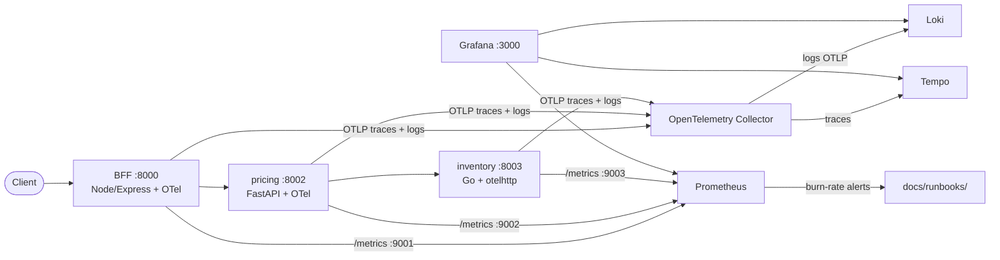

# SRE Observability Lab — distributed tracing across Node / Python / Go

An end-to-end **observability showcase** built the way production systems
actually look today: a **Node BFF** fronting a **Python** and a **Go**
service, fully instrumented with OpenTelemetry, feeding metrics, logs and
traces into a Grafana observability stack — with real **SLOs, error budgets
and multi-window burn-rate alerts**.

Not a "hello world": this repo encodes the practices I run for 24x7 systems
at scale — RED method as the default view, SLOs measured at the user-facing
edge, alerts derived from error budget burn with multi-window detection, and
a runbook attached to every alert.

## Why this architecture

- **BFF pattern** mirrors the storefront apps I lead (client + Node BFF
  service in one deployable), with backend services in the languages the
  backend teams actually use.
- **Three languages, one pipeline** proves the instrumentation pattern
  (traces + logs via OTel Collector, metrics via stable first-class
  exposition) works uniformly — that's the realistic constraint of
  polyglot organizations.
- **Error and latency injection** (5%/2% errors, heavy-tail tails) is
  deliberate: it makes burn-rate alerts and SLO math behave like production.

## Architecture



Then every 5xx in the BFF triggers a burn-rate alert in Prometheus that
links to `docs/runbooks/latency-error-burn.md`.

## Quickstart

```bash
docker compose up --build
```

| Service | URL | Purpose |
|---|---|---|
| Grafana | http://localhost:3000 | dashboards: "Service Overview - RED + SLO" |
| BFF API | http://localhost:8000/api/orders | user-facing chain demo |
| Prometheus | http://localhost:9090 | SLO rules & burn-rate alerts |
| Tempo | http://localhost:3200 | distributed traces (bff→pricing→inventory) |
| Loki | http://localhost:3100 | graded logs |

The **loadgen** keeps traffic so dashboards, exemplars and burn-rate alerts
have live data continuously.

## What is implemented

- **3 polyglot services** (Node/Express, Python/FastAPI, Go) instrumented
  with OpenTelemetry: one trace spans all three.
- **OTel Collector pipeline** with filtering of synthetic endpoints
  (`/healthz`, `/metrics`) and batching.
- **Dashboard-as-code** provisioning (datasources with exemplars and
  trace-to-logs cross-links, RED + SLO panels).
- **SLOs** at the user-facing edge: 99.9% availability, 99% under 500ms —
  error budget calculations and multiwindow burn-rate alerting both wired to
  runbooks (see [`docs/slo.md`](docs/slo.md)).
- **CI** — yamllint, ruff and Compose schema validation on every push.

## Roadmap

- [ ] Alertmanager with routing + inhibition rules
- [ ] Synthetic checks (blackbox) as a fourth signal
- [ ] React client that generates real user-grade traffic (storesfront-like)
- [ ] k8s/Helm deployment (compose is for 10-second reproducibility)

## Convention

- Low-cardinality labels only. Anything you can do in the UI, do it in a
  file in this repo.
- AI agents see [`AGENTS.md`](AGENTS.md) before contributing.

## License

MIT — see [LICENSE](LICENSE).
